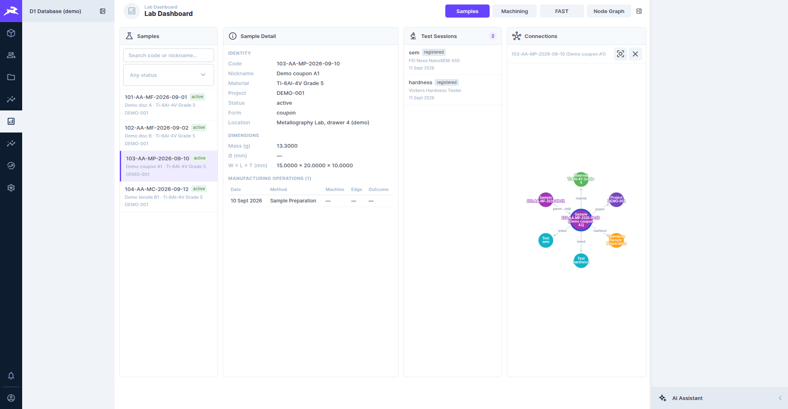
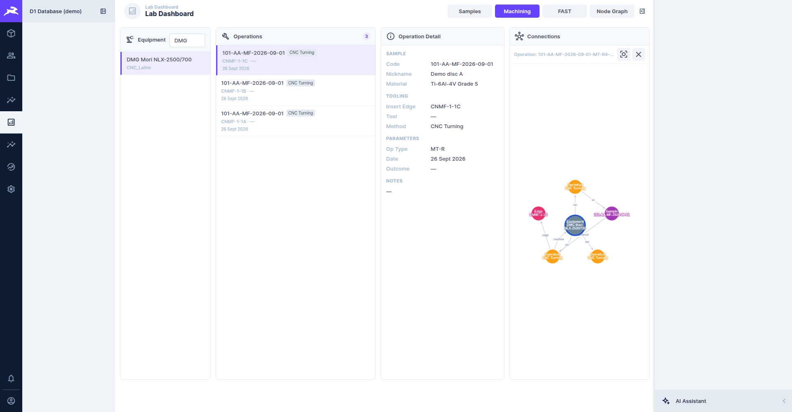
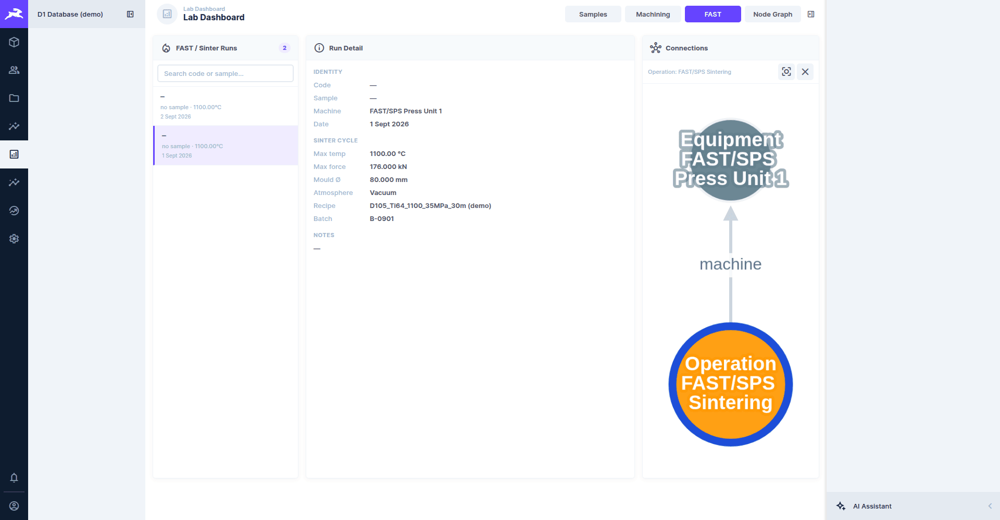
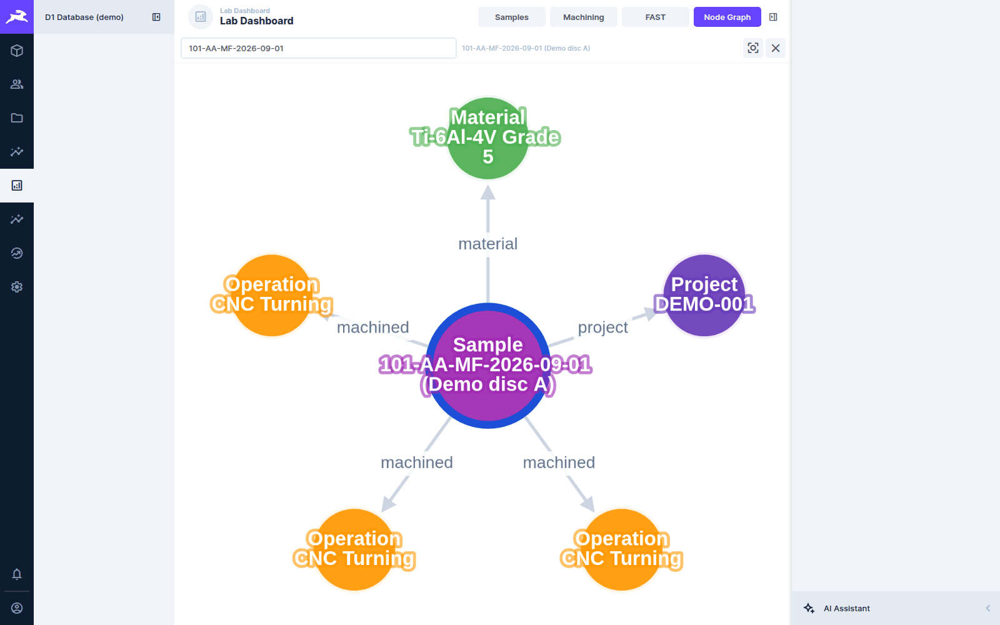
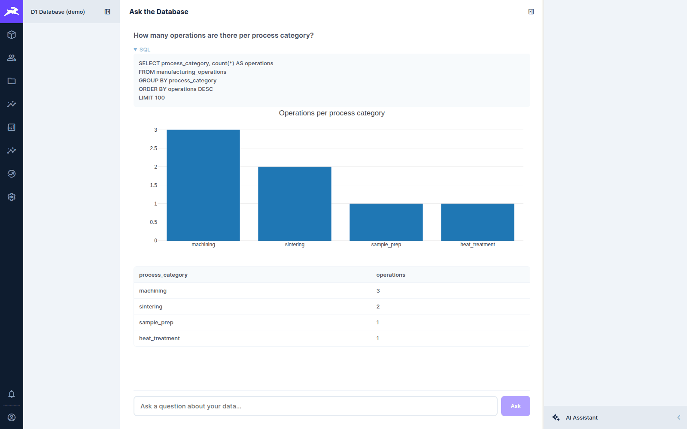
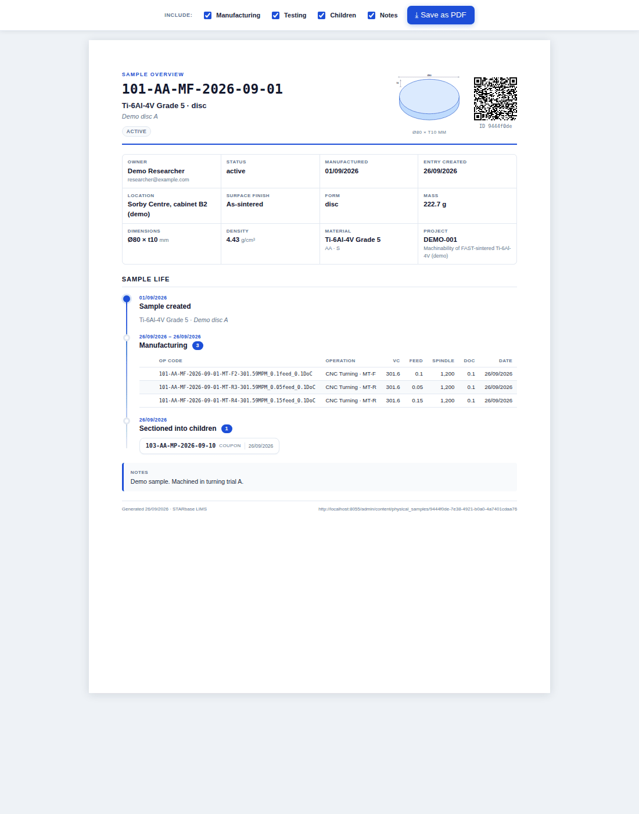
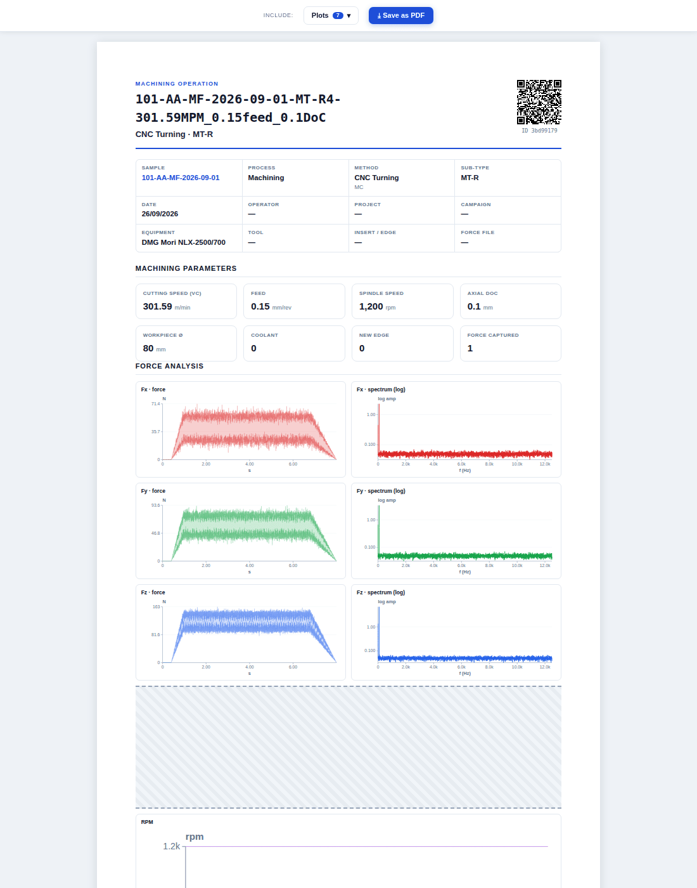
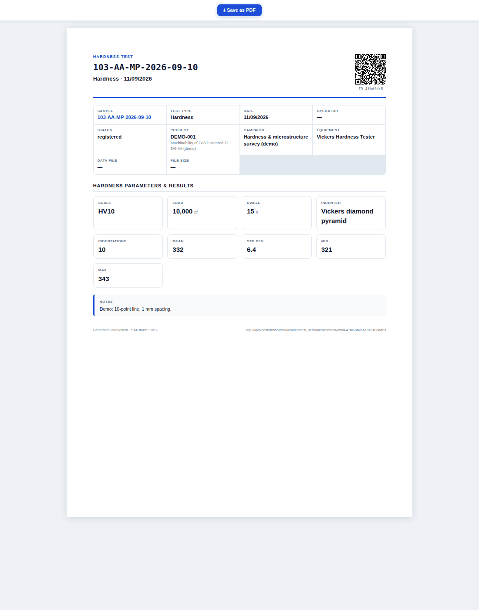

# Dashboards, Ask the Database and reports

[← D1 Database wiki](README.md)

Beyond Directus's own record lists, D1 adds its own views. [Force Analysis](force-data.md) and
[FAST Analysis](fast-data.md) have their own pages. This page covers the rest.

## Lab Dashboard

**Lab Dashboard** in the module bar is an overview in four tabs. Each tab is a chain of columns:
pick something on the left and the columns to its right fill in. The **Connections** column on the
right draws a graph of the selected record's neighbours.

### Samples

Search or filter the samples by status, then pick one to see its identity and dimensions, its
manufacturing operations (date, method, machine, edge, outcome) and its test sessions.

The **Timeline** tab beside *Sample Detail* shows the sample's whole story in one list: the raw stock
lot it came from, its ancestors (oldest first), the sample itself, its operations and tests in
date order, and the samples made from it. Every entry links to its record. You only see records
your role can read; anything else is summarised as "N items are not visible to you". If the
walk to a relative passes through a sample you cannot see (on every route to it), the entry says so,
and so does a raw stock lot reached through such a sample. A very long history shows the nearest
500 relatives and the newest 500 operations and tests, with a note.

### Machining

Pick a machine to list its operations, then an operation to see its sample, tooling and
parameters. The connection graph links the operation to its sample, edge and machine.

### FAST

FAST sintering runs with their sinter-cycle summary (peak temperature and force, mould
diameter, atmosphere, recipe, batch). For the full traces, use [FAST Analysis](fast-data.md).

### Node Graph

A full-screen version of the connections graph. Search for a sample, operation (by its code),
machine, insert, edge or box, pick it from the results, and the graph draws its neighbours:
material and project, operations and tests, machine, tooling, parent samples. Click any node to
explore outward from it. Each exploration adds to the graph; ✕ clears it and ⌖ re-fits it.

## Ask the Database

**Ask the Database** (from Home) answers questions about the lab data in plain English:

1. Click one of the example questions on the empty page, or type your own, e.g. *"How many
   operations are there per process category?"*, and press **Ask**.
2. A **self-hosted** language model (Ollama, running on d1-server) writes a SQL query. The query
   is shown under **SQL** so you can check what was actually asked.
3. The query runs, and the answer comes back as a table, with a chart when the result suits one.
4. Follow-up questions refine the previous one (*"only for Ti-6Al-4V"*).
5. At most 200 rows are shown. When a result is longer, the page says *"Showing the first N
   rows"*: ask for something more specific (a filter or a count) to see the rest.
6. Above each answer, **Download CSV** saves the table as a spreadsheet-ready file (named after
   the question and the date), **Copy SQL** copies the query, and **Save question** pins the
   question to the **Saved** list.
7. The empty page lists your **Saved** questions and your last 20 **Recent questions** (only the
   first question of each conversation is kept, because a follow-up needs the turns before it), each with
   **Run again** and **×** to remove it. They are kept in this browser only, for your account
   (not on the server, and not visible to colleagues, even on a shared computer); only the
   question text is stored, never the answers. Clearing the site data or using a private window
   empties them.

There is no thumbs-up/down feedback on answers yet: it needs somewhere to store it, which is a
separate decision.

The model is **never trusted**. Its SQL goes through two independent guards before it touches
data:

- an application **SQL guard** that parses the query (with a real SQL parser) and accepts only a
  single read-only `SELECT`. It rejects anything touching credential tables or Directus's
  auth and system tables, and wraps the query in a row limit. Lab tables and the `v_*` reporting
  views are readable;
- a **read-only Postgres role**, so even a query that got past the guard could not change
  anything.

A question the guard rejects comes back with a plain explanation, the reason and the SQL, plus
the example questions, so you can rephrase it. If the page says the service could not be reached
or timed out, the language model may be starting up: try again shortly. No
data leaves the server. See [ADR-0009](../../adr/0009-text-to-sql-guarded-readonly.md) and the
[text-to-SQL runbook](../../runbooks/text-to-sql.md).

> The screenshot's answer was stubbed: the text-to-SQL service was not running on the demo
> stack. The SQL was written by hand, and the table and chart are that SQL's real result on the
> demo data.

## Printable reports

The `d1-report` endpoint renders print-ready reports (A4, one or two pages) for three kinds of
record. Open one from the **Generate PDF** button at the top of a sample, operation or test form (the
`d1-report-button` field, added by migration `20261003000117_report_buttons.sql`; restart Directus
after applying it so the form metadata is reloaded), or directly at:

| Report | URL |
|---|---|
| Sample overview | `/d1-report/sample/<sample id>` |
| Operation datasheet | `/d1-report/operation/<operation id>` |
| Test datasheet | `/d1-report/test/<session id>` |

**Save as PDF** at the top prints the report. The checkboxes beside it choose what to include.
Each report carries a QR code that links back to the record. Labels for the physical samples are
in the next section.

| Sample overview | Operation datasheet | Test datasheet |
|---|---|---|
|  |  |  |

- The **sample overview** covers identity, owner, location, dimensions, material and project,
  then the sample's life as a timeline: created, manufacturing operations, tests, and child
  samples cut from it. Toggle *Manufacturing*, *Testing*, *Children* and *Notes*.
- The **operation datasheet** has the machining parameters, and for a force capture its force and
  spectrum plots per axis, plus RPM. *Plots* chooses which plots to include.
- The **test datasheet** has the test's type-specific parameters and results, e.g. hardness scale,
  load, dwell, number of indents, mean, standard deviation, min and max.

## Sample labels and QR codes

**Labels** (from **Home**, the **Print label** button on a sample, the sidebar **Labels** entry,
or "Print labels for selected" on the samples index) is an in-app Explorer page where you choose
samples, pick a template, and print. Samples and labels stay on screen (no separate tab): search
or filter by project / campaign, tick samples in a list, or paste sample codes. Set copies per
sample and, on a part-used sheet, the start position to skip used labels. The preview shows the
layout live; **Print** sends the same markup to your printer.

**Templates** are data, held in a collection. Each template defines page geometry (A4, roll,
custom), label size and margins, gap between labels, label arrangement (QR on top, QR on left,
or text only), the fields to show (sample code, short ID, nickname, material, date, owner
initials), their sizes and bold on or off, and which extras go into the QR payload (all of them unless you untick "All (default)"). Everyone can
create a template and edit or delete their own; admins can edit or delete any (the plain Directus
form is the admin fallback). Pre-built templates:

| Template | Geometry | Size | Arrangement |
|---|---|---|---|
| **A4 4×5** (default) | A4 page, no margins or gaps | 52.5 × 59.4 mm | QR on top, bold code, nickname |
| **L7160 21-up** | A4 sheet, margin-top 15.15, margin-left 7.25, gap-x 2.54 | 63.5 × 38.1 mm | QR on left |
| **50×25 single** | Roll | 50 × 25 mm | QR on left |
| **Brother DK-22205 62 mm** | Roll, 62 × 30 mm | 62 × 30 mm | QR on left, code and short ID |

**Printing.** On a part-used A4 sheet, set **Start at position** to skip used labels. Print at
**100 %** scale ("Actual size", not "Fit to page"), with **margins set to None**, or the labels
drift off the die-cuts. This applies to office lasers (A4 sheets) and the Brother QL-700 label
printer (62 mm roll on USB through its Windows driver).

**What the QR code says.** Anyone with a phone camera can read it, with no login and no database
access. It is plain text: `D1 SAMPLE`, then the sample code and short ID, the material and
nickname, the date and owner initials, the owner's email and `Contact: <lab email>`. A value that
is empty is left out. The lab contact email is one setting for the whole lab, shown under
**Template** on the labels page ("Contact on labels: ..."); admins can change it there. A label
that is too small for this much text drops to a lower error correction, and the preview warns
"QR may be hard to scan on this label size" when it may not scan.

Each label shows the sample code, a QR code, the material and date (manufactured if available,
else created), and the owner's initials. Samples you may not read get no label (the page says so);
material and owner appear only if your role can read those collections. Each field shrinks to a
minimum size, then is cut off with "…"; the preview flags labels that were clipped.

**QR and scanning.** The QR payload is self-describing plain text, readable by any phone with no
login, so the QR is **not private**. It starts with `D1 SAMPLE`, then the sample code and short
ID, then the fields the template chose (nickname, material, date, owner initials). The Finder
can scan a printed label or a pasted payload to open the sample. **Old labels** (printed before
these pages existed) encode `/admin/content/physical_samples/<id>`, the Data Studio form, which
still works. Scanning with a phone opens that record in the Directus app, sign-in first if
needed. Every record you can see is limited by your role's permissions. `PUBLIC_URL` must be
the address phones can reach.

**Old URLs.** The label routes `/d1-report/label` and `/d1-report/labels` are redirected to the
Labels page, carrying sample ids and codes over as query parameters.

## Insights

Directus's own **Insights** module (in the module bar) builds dashboards from panels: counts,
time series, lists. It is there for ad-hoc dashboards. D1's own views above cover the common
cases.
