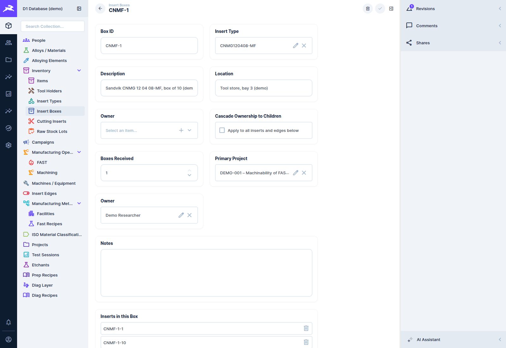
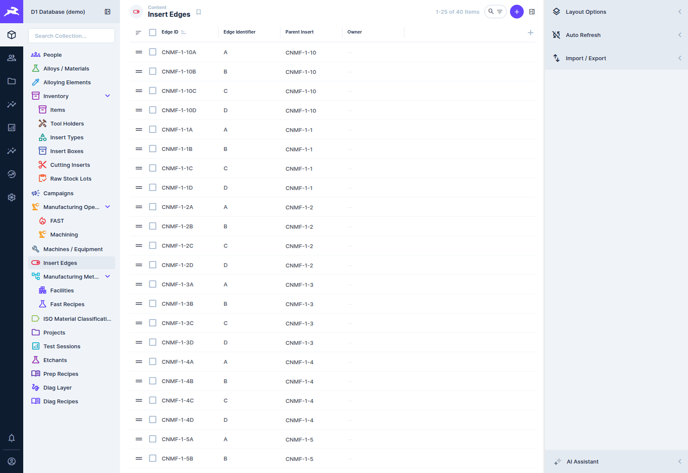
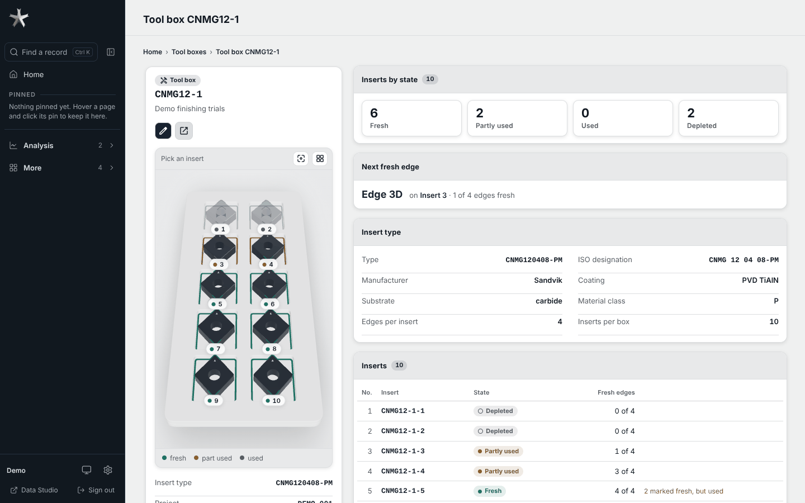
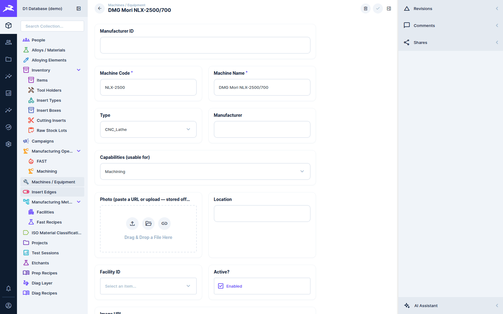

# Tooling and equipment

[← D1 Database wiki](README.md)

## The tooling hierarchy

Cutting tools are tracked down to the individual **cutting edge**, because wear and force are
properties of an edge:

```
Insert Types      catalogue: manufacturer, ISO designation, substrate, coating,
                  inserts per box, edges per insert
  └ Insert Boxes      a physical box of inserts            e.g. CNMF-1
      └ Cutting Inserts   one insert in the box             e.g. CNMF-1-1
          └ Insert Edges      one cutting edge of the insert   e.g. CNMF-1-1A … CNMF-1-1D
```

**Tool Holders** (`tools`) are recorded separately and linked on the operation.

### Receiving a box

When a delivery arrives, create one **Insert Box** record with its **Insert Type** and the
**Boxes Received** count. On save, the database expands it (`expand_tool_box_intake()`, run by a
database trigger when the box still has its placeholder code). That one entry becomes:

- *N* box records (the first is the one you created, the rest are clones),
- as many **cutting inserts** per box as the insert type holds,
- as many **edges** per insert as the insert type has (A, B, C…),

with every code generated in the pattern `{short code}-{box #}-{insert #}{edge letter}`.





### Ownership

A box has an owner and a **Cascade Ownership to Children** toggle. Changing the owner with the
toggle on also reassigns every insert and edge in the box (a database trigger, in the same save).

### Edges in use

An edge records whether it has been used. When you pick an edge on a machining operation,
**New Edge Used?** fills itself in: *yes* for an edge that has never been used, *no* otherwise.
You can still change it. Recording the edge on every pass is what makes the Force App's
[wear trend](../force-app/plot-dashboard.md#wear-trend-and-metadata-doctor) work.

## The tool box page

In STARbase a tool box, one of its inserts and one of their edges are a single page with a 3D model of
the box in the side rail. Open it from Inventory → **Tool boxes**, **Cutting inserts** or **Insert
edges**, or from any box, insert or edge code on another page.



| You are on | Address | The model shows | Beside it |
|---|---|---|---|
| the **box** | `/tool-boxes/<id>` | the tray, its numbered inserts coloured by state | how many inserts are fresh, partly used, used or depleted; the **Next fresh edge**; the insert type; the inserts |
| an **insert** | `/inserts/<id>` | that insert lifted out of its pocket, with its lettered edges | the insert's details and notes, and its edges with their state |
| an **edge** | `/edges/<id>` | a close view of that edge, highlighted | the edge's details and its **history**: every test and operation run with it, newest first |

- **Moving around.** Click an insert in the model (or in a list) to go to it, then click one of its
  edges. **Esc**, the **Up** button or the breadcrumb goes back up a level; the arrow keys step to the
  next insert or edge, and **Page Up / Page Down** to the next insert. Drag to turn the model and
  scroll to zoom; **Reset view** puts it back. Each step is its own address, so the browser's Back
  button, a pin or a copied link land on the same view.
- **Colours.** Green is fresh, amber partly used, grey used; a depleted insert is faded. The
  **next fresh edge** glows briefly when you arrive.
- **Next fresh edge.** The box suggests the edge to use next: the first fresh edge (A, B, C, D in
  that order) on the lowest-numbered insert that is already partly used, so inserts are used up
  before new ones are opened, and a two-sided insert's top face before its underside. With no partly
  used insert, it is the first fresh edge of the lowest-numbered insert.
- **Used is what the edge says.** An edge counts as used when its **Used?** toggle is on. If tests or
  operations name an edge that is still marked fresh, the page warns *Marked fresh, but N tests or
  operations used this edge*: switch it on in the edge's **Edit**.
- **History.** An edge's history lists the tests that name it (also as one of several subjects) and
  the machining passes run with it; **View forces** opens the pass in the Force plotter.
- **Without 3D.** On a computer without WebGL, or in a narrow window, the model is replaced by a flat
  grid of the slots and an outline of the insert, with the same clicks and addresses. **2D grid**
  switches to it on purpose.

### How the shape and the letters are drawn

The model is drawn from the insert type, not from a CAD file:

- the **ISO designation** gives the shape (C, D, S, T, V, W, R), whether the insert is one- or
  two-sided, the hole, the size, the thickness and the nose radius (for example `CNMG 12 04 08`:
  80° rhombic, two-sided, 12.7 mm, 4.76 mm thick, 0.8 mm nose);
- a value filled in on the insert type (**Nose Radius RE**, **Cutting Edge Length L**, **Included
  Angle ESPR**, **Fixing Hole Ø**) wins over the designation;
- **Usable Edges Per Insert** caps the cutting corners: an insert type with fewer edges than its shape has
  cutting corners gets letters on that many corners only, from A;
- if the designation cannot be read, a plain shape is drawn from the edge count, with *Shape not
  recognised*.

The chip breaker is not modelled: the top face is flat.

Edge letters follow the lab's rule: hold the insert with its **reference mark** up; **A** is the
cutting corner nearest the mark, and the letters run **clockwise**, top face first. On a two-sided
insert the underside continues the letters with **C directly under A** (and D under B on a CNMG).
Only corners that cut get a letter: a CNMG has A–D, a single-sided CCMT only A and B. Old edges
named `fA`, `fC` use the same letters.

**Tipped inserts (PCD, PCBN).** A tipped insert comes one per small box and has one cutting edge, the
brazed tip. Give its insert type a **Usable Edges Per Insert** of 1 and a **Substrate** of *PCD*,
*PCBN* or *CBN* (a type code or designation ending in one of those works too): the box draws as a single small case, the tip shows in a lighter diamond finish on
corner A, and the insert has edge A only.

## Machines and equipment

**Machines / Equipment** lists every machine and instrument, grouped under **Facilities** (the
labs and centres that house them).



| Field | Notes |
|---|---|
| **Machine Code** | a short code. If you leave it blank, a unique 6-character code is generated. |
| **Machine Name**, **Type**, **Manufacturer** | as named |
| **Capabilities (usable for)** | the process and test categories the machine can do: `machining`, `sintering`, `heat_treatment`, `additive`, `sample_prep`, `nde`, `destructive`… |
| **Facility**, **Location**, **Active?** | where it is, and whether it is in service |
| **Photo**, **Image URL** | a picture for the record and reports |

**Capabilities matter.** The *Machine* field on operations and tests only offers machines whose
capabilities include the record's process or test category. A machine with no capabilities never
appears there. Set them when you add a machine.

## Reference catalogues

These change rarely and are usually maintained by an administrator:

| Collection | Holds |
|---|---|
| **Manufacturing Methods** | method codes and names (`MC` CNC Turning, `MF` FAST/SPS Sintering…) |
| **Facilities** | labs and centres |
| **Manufacturers** | the manufacturer list used by equipment, tools and insert types |
| **Insert Types** | the cutting-insert catalogue |
| **ISO Material Classifications** | the ISO 513 P/M/K/N/S/H groups |
| **Alloying Elements** | the periodic-table reference for compositions |
| **Etchants** | metallographic etchants |
| **FAST Recipes** | FAST 25 / FAST 250 sintering recipes ([FAST data](fast-data.md)) |
