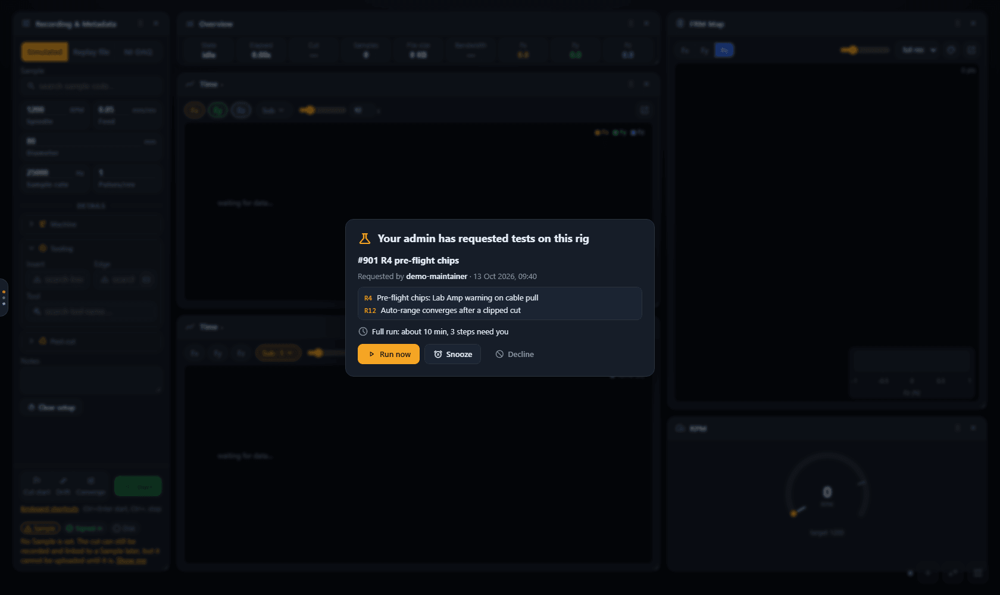
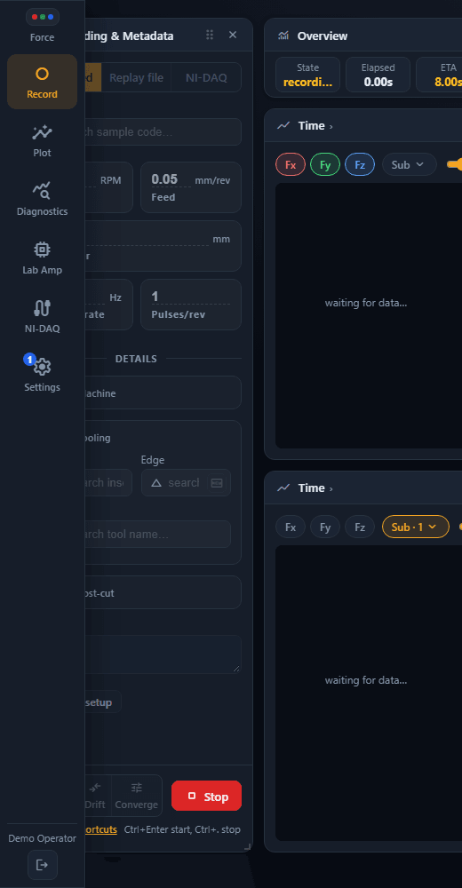
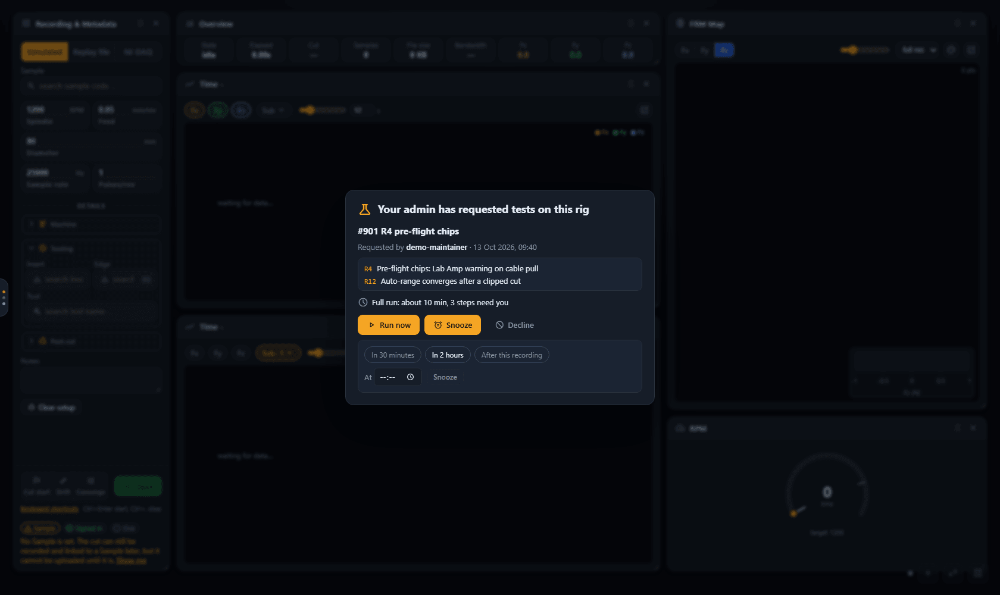
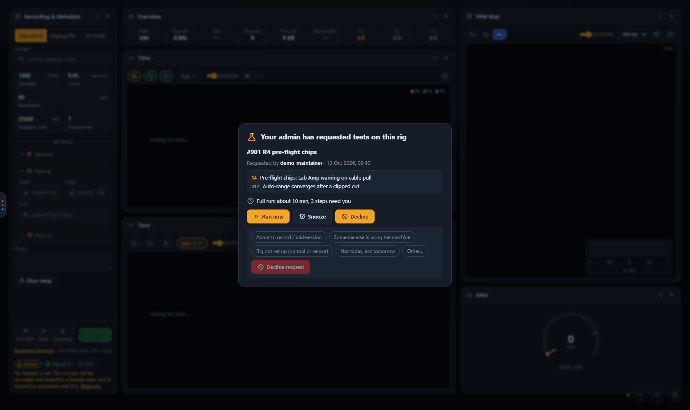
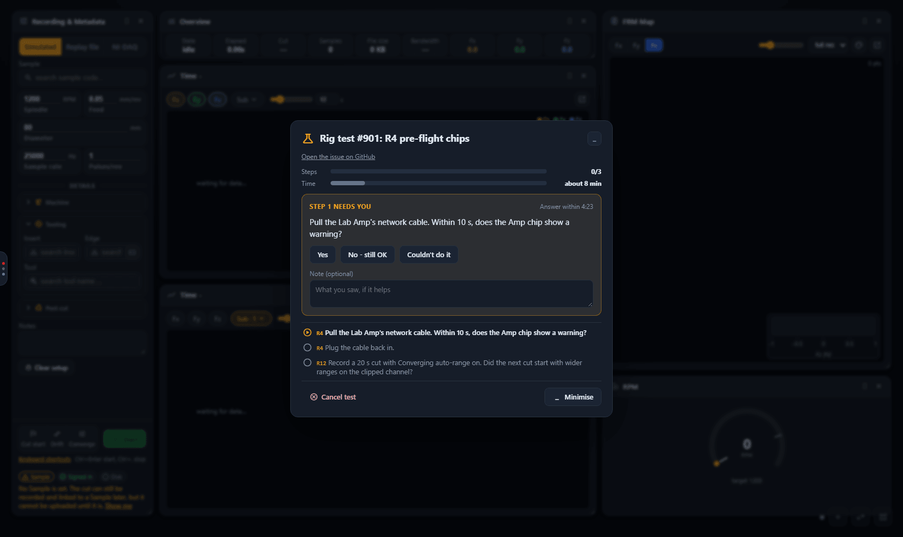
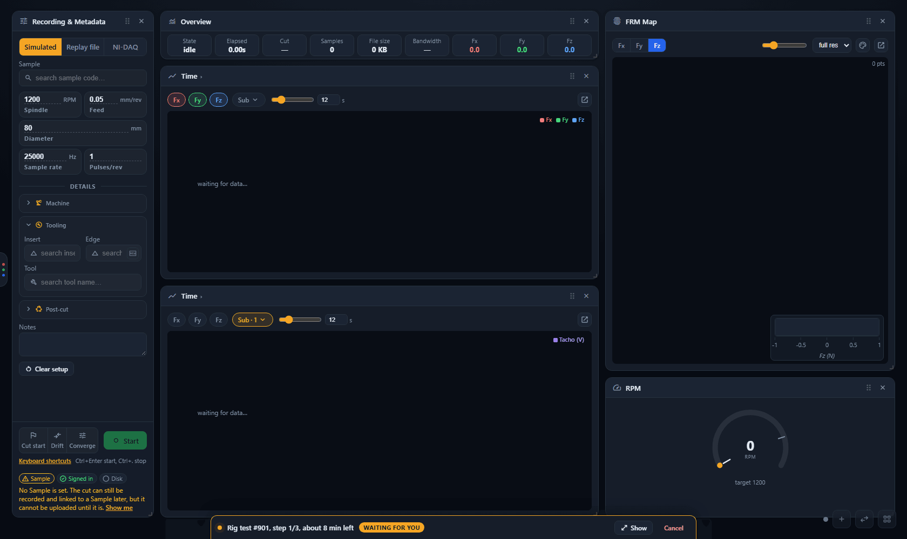
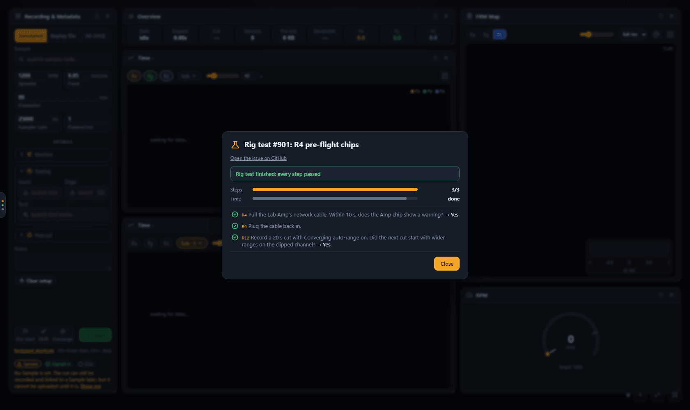
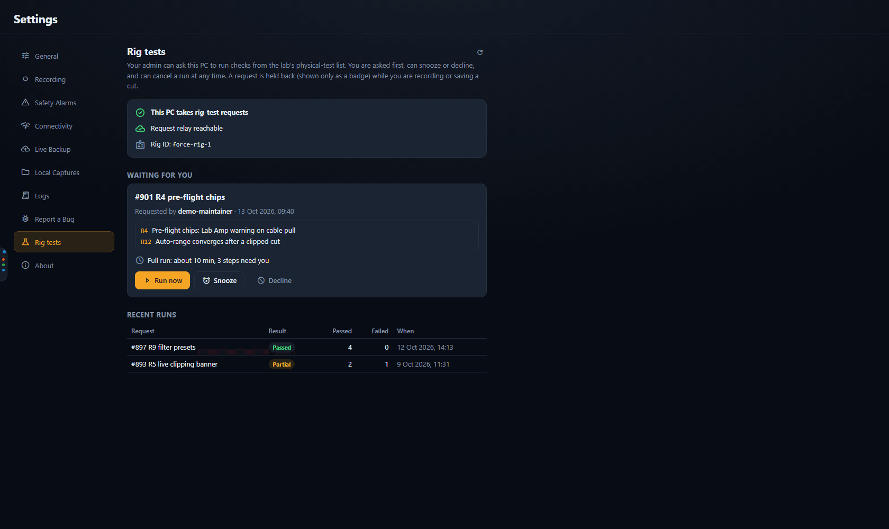
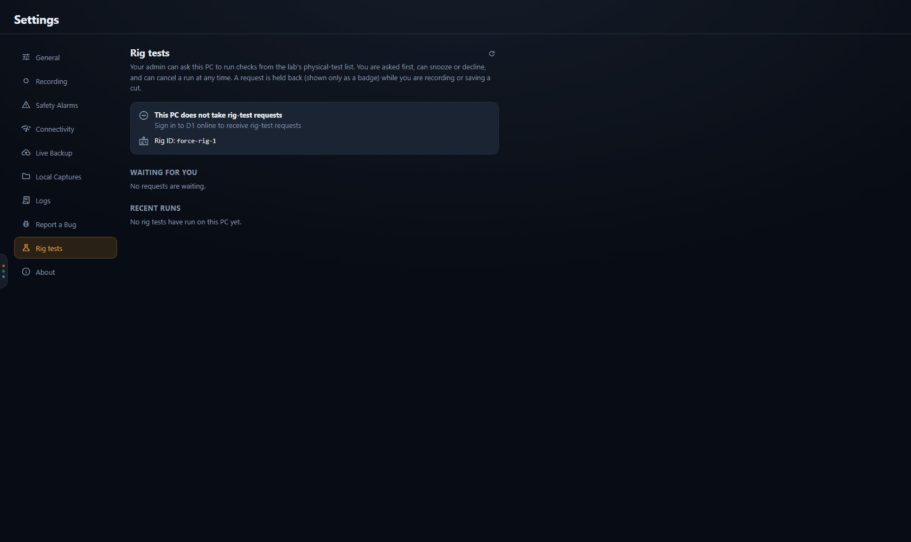
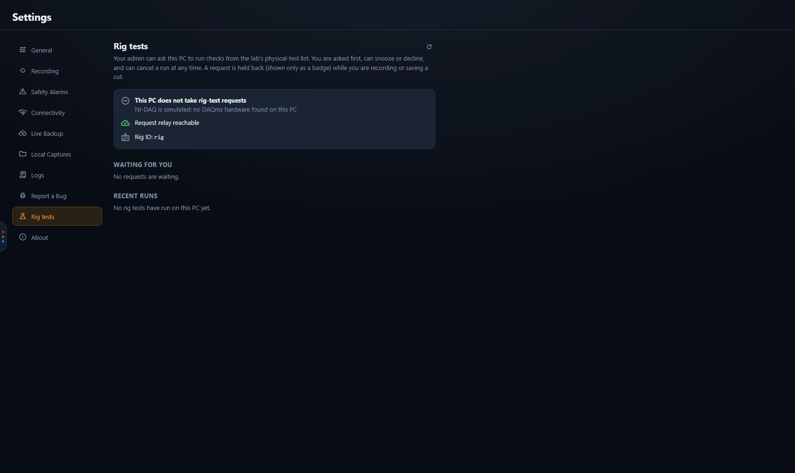

# Rig tests

[← Force App wiki](README.md)

Some fixes can only be confirmed on the real rig: the NI-DAQ chassis, the Lab Amp, the packaged
app. Rather than wait for a rig day, a maintainer can **request a rig test**: a short list of
checks that the app on the rig PC offers to whoever is using it. You choose whether and when to
run them. The app walks you through each check, and posts the answers back to the request.

Rig tests arrive in Force App 0.1.37. This page has two halves:

- [**At the rig**](#at-the-rig): for the person using the rig PC when a request arrives.
- [**Requesting a test**](#requesting-a-test): for maintainers who want something checked.

## At the rig

### What a request is

A request is a GitHub issue that names the lab's checks to run (for example *R4, pre-flight
chips*). Each check is a short procedure from the lab's physical-test list: do something at the
rig, then tell the app what you saw. Nothing runs on its own and nothing in a request can change
the rig's settings: the app only shows you the questions and records your answers.

### When the prompt appears

The app only offers requests on a PC that is **really on the rig**, and only while someone is
**signed in to D1 online**:

- the NI-DAQ source is the real chassis (not the simulated one), and the Lab Amp is not in mock
  mode; and
- you are signed in with a connection to D1. A [session you started offline](working-offline.md)
  does not count: the app asks you to sign in online instead.

Any D1 user can receive and answer requests, on any laptop plugged into the rig. Nothing needs to
be set up on the laptop. A request can take up to a minute to arrive after it is made.



*A request arrives as a dialog on whatever page is open. It says who asked, which checks it
contains and how long the full run should take.*

The dialog has no close button and ignores Escape, so a request is never dismissed by accident.
You answer it with one of three buttons. If several requests are waiting, they are offered one at
a time, oldest first.

**While you are recording or saving a cut, the dialog does not appear.** A cut is never covered.
Instead the sidebar's **Settings** item shows a numbered badge (and the collapsed sidebar handle
shows a dot). The dialog opens once the cut is saved or discarded, or you can open **Settings →
Rig tests** at any time to answer the request there.



*The badge on Settings while a cut is recording. The request waits until the cut is over.*

If the app is in the background when a request arrives, you also get a **Windows notification**
and the taskbar button flashes.

### Run now, Snooze or Decline

| Button | What it does |
|---|---|
| **Run now** | starts the run. The app refuses, and says why on the dialog, if a recording, a save, a recovery or an upload is in progress. |
| **Snooze** | hides the request and brings it back later: in 30 minutes, in 2 hours, at a time you type (a time that has passed today means tomorrow), or after this recording is saved. |
| **Decline** | refuses the request. You pick a reason first (below). |



*Snooze presets and an "At" time.*

Declining needs a reason, so the person who asked knows whether to try again. The ready-made
reasons are:

- About to record / mid-session
- Someone else is using the machine
- Rig not set up (no tool or sensor)
- Not today, ask tomorrow
- Other…, with a short note of your own (up to 300 characters)



*Choose a reason, then **Decline request**.*

Snoozing and declining are both posted on the request, with the rig ID and (for a decline) your
reason, so the maintainer sees what happened.

### The run window

**Run now** opens the run window. It shows the request, two progress bars (steps done, and time
used against the estimate), the current step and the list of steps with a mark beside each.



*A question. The countdown is how long the step waits for you.*

- **Questions.** A step that needs you shows what to do, answer buttons and an optional **Note**
  ("what you saw, if it helps"). Pressing an answer records it and moves to the next step. Some
  steps are an instruction only (for example *Plug the cable back in*) and just need **Done**.
- **The countdown.** Each question waits for at most five minutes, or one and a half times its
  estimate if that is longer, and the countdown above it shows the time left. If it reaches zero
  the step is recorded as **no response** and the run carries on. A whole run also has an overall
  time limit; when it is reached the run ends as **timed out**.
- **Checks without written steps** (older entries in the lab's list) appear as one question: the
  check's description with **Pass**, **Fail** and **Skip**.
- **Minimise.** The **Minimise** button, or Escape, shrinks the window to a bar along the bottom
  of the screen so you can use the rest of the app. The test keeps going. Whenever a *new*
  question needs you, the window pops back up by itself (unless you are recording; see below).
- **Cancel.** **Cancel test** asks you to confirm, then stops the run. Steps not yet done are
  recorded as cancelled.



*The minimised bar: step 1 of 3, about 8 minutes left, and a tag showing that a question is
waiting for you. **Show** reopens the window.*

If you start recording while a test is minimised or running, the window holds back the same way
the prompt does: a running test shows only as the bar (tagged *Waiting for you, after this cut*
when it needs an answer), and nothing pops over the cut. A summary that arrives during a cut waits
until the cut is over.

When the last step is done, the window shows a summary and **Close**:



*Every step passed. A run with a failed, skipped or unanswered step says "some steps did not
pass"; a cancelled or timed-out run says so.*

### What is posted back

The results go to the request's GitHub issue, which in this project is public. So:

- **You appear as initials only** (for example *D.O.*), taken from your D1 name. Your name and
  email are never sent.
- The comments show the **rig ID** (see below), the app version, the times, and your answers.
- **Anything you type in a note, or in the Other… decline reason, is posted** (with Windows
  account names removed). Describe what you saw, but leave out personal details.

The request also gets a state label as it goes (see [the labels](#state-labels)).

### Settings → Rig tests



*Settings → Rig tests on a PC that takes requests: relay reachable, rig ID, a request waiting and
two earlier runs.*

The tab shows:

- whether **this PC takes rig-test requests**, and if not, why (see below);
- whether the **request relay** (the d1-server service that reads GitHub) is reachable;
- the **Rig ID**;
- **Waiting for you:** the pending requests, each with the same Run now / Snooze / Decline
  buttons, and **Snoozed:** the requests you snoozed, with when each returns;
- **Recent runs:** earlier runs on this PC with their result, passes and fails.

The **Rig ID** is the name the rig announces on GitHub. It is `rig` unless an administrator has
given this laptop another (the screenshots use `force-rig-1`). A maintainer can aim a request at
one rig by that ID. It is also shown in [Settings → About](settings.md#about).

When a PC does not take requests, the tab says why in the first box:



*Signed in offline or signed out: "Sign in to D1 online to receive rig-test requests".*



*A PC with no real NI-DAQ: "NI-DAQ is simulated: no DAQmx hardware found on this PC".*

The reasons, and what to do about each, are in [Troubleshooting](troubleshooting.md#sign-in-to-d1-online-to-receive-rig-test-requests).
Rig-test requests are answered in the app's main window only, never in a pop-out.

> The screenshots on this page show a scripted recorder backend (the demo stack has no rig, so
> the requests, the run and the Settings states were supplied by a script). The request is
> `#901` from the demo maintainer `demo-maintainer`; no real issue or person appears.

## Requesting a test

You need to be a GitHub login on the relay's allowlist (see [who may request](#who-may-request)).

1. **Open an issue** in the project's repository. The title is what the operator sees (for
   example *R4 pre-flight chips*).
2. In the body, add one fenced block tagged `rig-test` that lists the backlog ids to run:

   ````markdown
   ```rig-test
   rig: force-rig-1          # optional: only this rig answers; leave out for any rig
   items: [R4, "#185", R12]
   ```
   ````

3. **Add the label `rig-test-request`.**

The app on the rig picks the request up within a minute or so, if someone is signed in there.

### The `rig-test` block

- `items` lists backlog item ids. An id is the bold id at the start of an item in
  [`docs/runbooks/physical-test-backlog.md`](../../runbooks/physical-test-backlog.md): a
  letter-and-number id like `R4` or `E5-fix-ui`, or an issue number like `#185`. **Quote the
  issue numbers** (`"#185"`): an unquoted `#` starts a YAML comment. Up to 20 items.
- The app reads items from the copy of the backlog **built into the release on the rig**, not from
  your issue. So a request can only name items that exist in that app version. If one id is
  unknown (the comment says *unknown item 'R99' (not in this app version)*), **the whole request is
  declined**, not just that item: the operator is never asked. An id that matches several items
  (some old ids repeat) is refused the same way, with a message asking for the full id. A new rig
  item gets its own bold id when it is added to the backlog.
- `rig:` is optional. A rig whose ID differs ignores the request silently. Rig IDs are compared
  without regard to case.
- You can add one-off questions under `steps:` for a check that is not in the backlog. They can
  only show text and answer buttons; nothing in the issue is ever run:

  ````markdown
  ```rig-test
  items: [R4]
  steps:
    - ask: Is the spindle-speed chip green with the spindle stopped?
      options: [Yes, "No"]
      pass: [Yes]
      est: 60s
  ```
  ````

- There must be exactly one block, and the issue body must be under 64 KB. If the request cannot
  be understood, the operator never sees it: the app comments on the issue with the reason, labels
  it `rig-test:declined`, and waits for you to fix the block and remove that label.

### Who may request

The d1-server relay has an allowlist of GitHub logins (`RIG_TEST_ALLOWED_LOGINS`, see
[Administration](../database/administration.md#rig-test-requests)). **Both** of these must be on
it, or the request is invisible to every rig:

- the login that **opened the issue**, and
- the login that **last applied the `rig-test-request` label**.

Both are checked because the body of an issue can be edited after the label is on. If you edit
someone else's issue, or someone not on the list labels yours, nothing happens (and nothing says
why): ask an administrator to add the login.

### State labels

The app sets one `rig-test:` label on the issue as the request moves along, and replaces it as the
state changes. It leaves `rig-test-request` where it is.

| Label | Meaning |
|---|---|
| `rig-test:deferred` | the operator snoozed it. It comes back by itself when the snooze ends. |
| `rig-test:declined` | the operator declined it (the reason is in a comment), or the request was invalid. |
| `rig-test:running` | an operator accepted it and the run is going. A progress comment is edited in place. |
| `rig-test:done` | the run finished and **every** step passed. |
| `rig-test:partial` | the run finished with a step that failed, was skipped or got no response, or it was cancelled or timed out. |
| `rig-test:interrupted` | the app closed or crashed mid-run. It is reported the next time the app starts. |

### The result comment

When a run ends, the app adds a **new comment**, so you are notified. It is a table with one row
per item, followed by the operator's notes (if any) in a collapsed section:

```markdown
### Rig test result: partial (force-rig-1, app 0.1.37, 14:02–14:13, accepted by D.O.)

| Item | Result | Evidence |
|---|---|---|
| R4 — pre-flight chips | ✅ Pass | operator: "Yes" |
| #185 — long cut | ➖ No response | no response from the operator |
| R12 — auto-range converges | ❌ Fail | operator: "No - still OK" (note below) |
```

Results are `Pass`, `Fail`, `No response`, `Skipped (earlier step not done)`, `Cancelled`, `Timed
out` and `Error`. An item takes the worst result among its steps. The comment ends with a hidden
machine-readable copy of the same result, which a Claude session reads when it ticks the item off
in the backlog (only a `Pass` ticks it).

### Asking again

A request that has a state label other than `rig-test:deferred` is not offered again. To re-offer
it (after a decline, a partial run, or to repeat a passed one), **remove its `rig-test:` label**.
The next poll shows it to the operator again, and the new run gets its own result comment.
Removing `rig-test-request` withdraws the request altogether.

## See also

- [Settings → Rig tests](settings.md#rig-tests): the tab, in the settings reference
- [Troubleshooting](troubleshooting.md): "Sign in to D1 online to receive rig-test requests" and
  the other reasons a PC does not take requests
- [Administration](../database/administration.md#rig-test-requests): the allowlist and the relay
- [Developer guide](developer-guide.md#rig-tests): how the pieces fit
